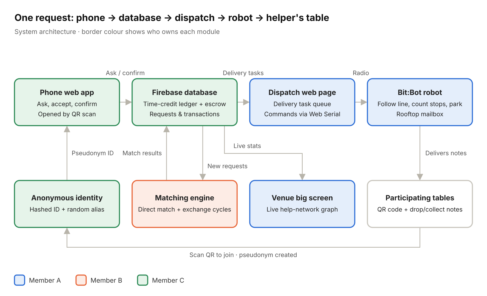
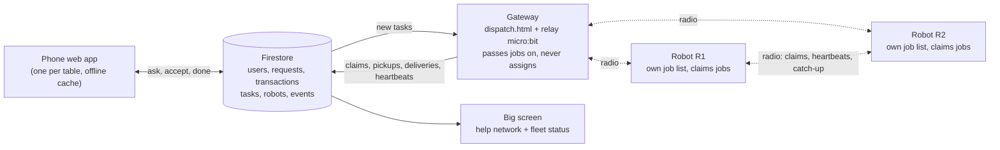
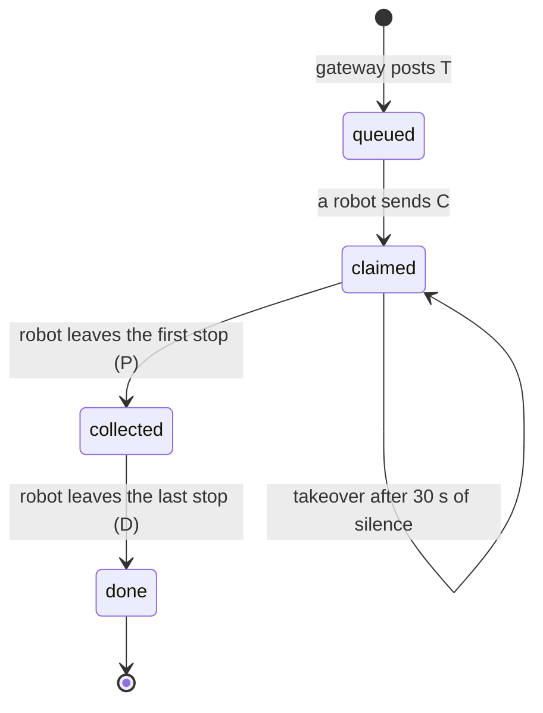
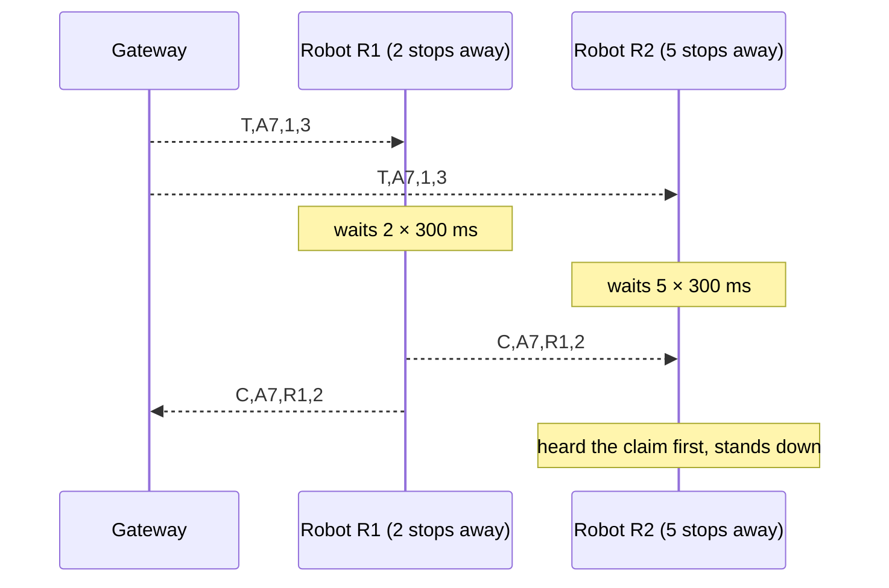

# Loop architecture (draft)

**Status:** draft for the team to agree, Saturday 14 November 2026. Nothing here changes the handbook plan up to the 20:00 make-or-break test. Open questions are in [brain/decisions.md](brain/decisions.md).

## The short version

The handbook design is a straight line: phone → Firebase → one dispatch laptop → one robot. The dispatch laptop decides everything, in order, one job at a time. That works for the main theme. Neptune North asks for the opposite: several actors that make their own decisions and keep making progress when the link to the centre drops.

The proposal keeps every part of the handbook and changes one thing after 20:00. The decision "which robot takes which delivery" moves out of the dispatch laptop and into the robots. The laptop becomes a **gateway**: it posts new jobs onto the radio and reports finished ones back to Firebase, but it never gives orders. With two robots on the track, you can unplug the laptop in front of the judges and the fleet carries on.

<details>
<summary>The handbook's current diagram, for comparison</summary>



</details>

## What we're aiming at

| Criterion | How Loop answers it |
|---|---|
| **Neptune North:** working towards a common goal | Two robots, a gateway and every phone in the room share one goal: get each help note to the right table |
| **Neptune North:** independent decision-making | Each robot keeps its own list of jobs and claims the ones it is closest to. Nobody assigns work |
| **Neptune North:** resilience when comms fail | Gateway or Wi-Fi down: robots finish every job they already know about. Robots can't hear each other: each finishes its own jobs, and duplicates are cleaned up on reconnect. Phones keep requests on the device until they're back online |
| **Neptune North:** something we're excited about | People really do get stuck and are too shy to ask. The fleet runs for real, all night, in the room |
| **Composition:** creativity and innovation | Robot, web app, a small economy and (proposal) music, mixed into one thing |
| **Composition:** technical competence | Escrow ledger with transactions, cycle matching, a radio protocol with no central scheduler |
| **Composition:** research and learning | Time banking, Top Trading Cycles, railway block signalling, gossip protocols |
| **Composition:** polish and completion | It runs live for 24 hours, with real data from the day on the big screen |

## Three ways to build it

| | A. Robots decide (recommended) | B. Laptops decide | C. Handbook as written |
|---|---|---|---|
| **How** | Robots keep their own job list and claim jobs over micro:bit radio. The laptop only passes jobs in and results out | One dispatch laptop per robot. Each laptop claims jobs in Firestore, using Firestore's offline cache | One robot, one dispatch laptop working through a queue |
| **Neptune North score** | Strong. The actors judges watch are the robots themselves, and radio needs no Wi-Fi | Medium. Firestore is still the hub; when Wi-Fi drops, the laptops can't see new jobs or each other's claims | Weak. A central hub is the thing the brief asks us to avoid |
| **Cost** | Robot program gets bigger (MakeCode JavaScript). Needs a third micro:bit | Needs two laptops tied up with USB. Code stays in JavaScript | Nothing extra |
| **Risk to the 20:00 test** | None if started after 20:00 | None if started after 20:00 | None |

**Recommendation: A, built on top of C.** C has to work by 20:00 whatever we choose. A then replaces the dispatch queue with the robot brain, in stages we can stop at any time (see [Build stages](#build-stages-and-cut-lines)).

## System overview (option A)



Solid lines need the internet. Dotted lines are micro:bit radio (group 7), which needs nothing but the boards.

## Actors

| Actor | Runs on | Knows | Decides on its own | If it loses contact |
|---|---|---|---|---|
| **Phone app** | Participants' phones, `index.html` | Its user's alias, balance and requests | What to ask for, which request to accept | New requests are saved on the phone and upload when it's back. Accept and Done wait, because balance changes need a live transaction |
| **Ledger** | Firestore transactions in `ledger.js` | All balances and escrow | Refuses anything that breaks the rules (not enough credits, accepting your own request) | Nothing settles while offline. Escrow means nobody loses credits |
| **Gateway** | Dispatch laptop, `dispatch.html` + relay micro:bit | Open tasks in Firestore; what robots report | Nothing about who drives where. It only translates between Firestore and radio | Robots carry on. When it's back it re-posts open tasks and writes what the robots report |
| **Robot** | Bit:Bot XL + micro:bit, MakeCode | Its own job list, its last stop line, where the other robot last said it was | Which job to claim, when to move, when to wait for the other robot, when to take over a job | Finishes its own jobs. Claims queued jobs it hears about. Shows a "can't hear anyone" icon |
| **Big screen** | `screen.html` on the venue monitor | Everything in Firestore | Nothing | Freezes on the last data |

## The robot brain

This is the new part. Everything else in the handbook stays as written.

### Each robot keeps its own job list

Every robot stores the jobs it has heard about: id (the request's short code, for example `A7`), stops, state, owner and cost. The list is small (under 20 jobs) and fits easily in micro:bit memory.

A job only ever moves forward:



Because states only move forward, merging two copies of the list is simple: keep whichever is further along. If two robots both claim the same job, the lower cost wins, then the lower robot number. Every robot applies the same rule, so they all reach the same answer without asking anyone.

### Claiming a job (no central scheduler)

When an idle robot hears about a queued job, it works out its **cost**: the number of stop lines it has to pass to reach the job's first stop. Then it waits `cost × 300 ms` before claiming. The closest robot's timer runs out first, it broadcasts its claim, and the others hear it and stand down.



If a claim gets lost and both robots claim, the tie-break rule above settles it, and the loser drops the job.

### Catching up

Every 2 seconds each robot broadcasts a heartbeat and re-sends one entry from its job list, taking turns through the list. A robot that missed a message, or was switched off, catches up within a few seconds of hearing the others.

### Taking over

If a robot hasn't heard from the other one for 30 seconds, it may claim the other robot's jobs that are still `claimed`. It never takes over a `collected` job, because that note is physically sitting on the other robot's roof.

### At a stop

The robot waits up to 30 seconds for the note to go in or come out. Pressing button A on the robot means "done, go on". This replaces the 30-second wait and the Next button on the handbook's dispatch page.

## Radio protocol

Comma-separated text. A micro:bit radio string holds at most 19 characters, so every message fits.

| Message | Example | Sent by | Meaning |
|---|---|---|---|
| `T` | `T,A7,1,3` | Gateway (robots re-send during catch-up) | New job A7: collect at station 1, deliver to station 3. Exchange cycles add stops: `T,C2,1,3,5` |
| `C` | `C,A7,R1,2` | Robot | R1 claims A7 at a cost of 2 stop lines |
| `P` | `P,A7,R1` | Robot | R1 has collected the note and left the first stop |
| `D` | `D,A7,R1` | Robot | R1 has delivered A7 |
| `H` | `H,R1,3,B` | Robot, every 2 s | Heartbeat: R1, last stop line 3, state `I` idle, `B` busy, `W` waiting for the track |
| `G` | `G,R1,3` | Gateway, manual buttons | Manual override: R1 go to station 3. `G,R1,0` sends it home |

The handbook's `GO:3`, `AT:3` and `HOME` keep working until stage 1 replaces them.

## The one-track problem

Both robots follow the same taped loop in the same direction, and they can't overtake. Two rules keep them from crashing or blocking each other:

1. **Block signalling** (the way railways do it). The track between two stop lines is a block. A robot may leave stop line `k` only if the other robot's last heartbeat does not put it at stop line `k+1` or inside the block just ahead. Otherwise it sends `W` and waits.
2. **Idle robots keep moving.** An idle robot does slow laps instead of parking. On a single loop, a parked robot blocks everyone behind it, and if that robot can't hear the others it will never move out of the way.

When the robots can't hear each other, rule 1 has nothing to go on. The safe fallback is to drop to crawl speed, and to fit a **4tronix ultrasonic sensor** if we can get one: the BitBot MakeCode extension has a sonar block, and a robot can always see what's in front of it even when it can't hear anything. Without the sensor, the person on duty watches and the robots move slowly enough that a bump is harmless.

## When things break

| What breaks | What keeps working | What the judges see | When it comes back |
|---|---|---|---|
| Venue Wi-Fi or Firebase | Robots keep delivering every job already on the radio. Phones save new requests locally | Requests marked "waiting to send" | Phones upload. The gateway posts the new jobs |
| Gateway laptop or relay micro:bit | Robots finish known jobs and share them with each other | **The demo moment:** pull the USB cable mid-delivery and the fleet carries on | The gateway re-posts open tasks. Robots re-send `P` and `D`. Firestore catches up, and replays are harmless because states only move forward |
| Robots can't hear each other | Each robot finishes its own claimed jobs | Each robot shows a "can't hear" icon. The big screen marks the other one as silent | Duplicate claims settle by cost, then robot number. A duplicate pickup finds an empty table and moves on |
| A robot dies (battery, knocked off the track) | After 30 s the other robot takes over the jobs it had claimed but not yet collected | Big screen: "R2 took over A7" | The revived robot starts with an empty list and learns the rest from catch-up messages |
| A robot dies holding a note | Can't be automated: the note is on its roof | The person on duty carries the note | n/a |

For the demo we need a way to cause failures on purpose:

- A **Hub offline** switch on the dispatch page that stops the gateway sending and receiving.
- Pressing **A+B** on a robot toggles "deaf mode": it ignores the radio and shows an icon.

## Data model changes

Additions to the handbook's model. Existing fields stay as they are.

```js
// tasks/{id}: three new fields, and status gains two values
{ stops: [3, 5], requestId: "...", createdAt: ...,
  code: "A7",                 // the job id on the radio (the request's short code)
  status: "queued",           // queued / claimed / collected / done
  owner: null,                // "R1" / "R2" once claimed
  updatedAt: ... }

// robots/{robotId}: written by the gateway from heartbeats, read by the big screen
{ lastStop: 3, state: "busy", job: "A7", lastSeen: ... }

// events/{id}: for the big screen and pitch data
{ at: ..., robot: "R2", kind: "claim",   // claim / collect / deliver / takeover / hub-offline / hub-online
  job: "A7" }
```

The gateway only ever moves a task's status forward. If a late message would move it backwards, it ignores it.

Events also give B the numbers for the pitch: deliveries completed while the hub was offline, takeovers, and average wait from request to pickup.

## Composition angle (proposal)

**An orchestra with no conductor.** Give every station a note of a scale. When a robot arrives at a station it plays that note through the micro:bit V2's built-in speaker. Over 24 hours the deliveries play out as a slow tune, and the big screen can draw them as a score next to the help network. When communication fails, the robots keep playing, like musicians who lose sight of the conductor and keep time with each other.

It costs one "play tone" block per arrival. Worth deciding before 17:00, because it shapes the pitch.

## Build stages and cut lines

| Stage | When | What | Owners | Done when |
|---|---|---|---|---|
| **0. Handbook loop** | Now to Sat 20:00 | Exactly as the handbook says. One robot, central dispatch | A, B, C | The H8 test passes twice in a row |
| **1. Robot decides** | Sat 20:00 to Sun 00:00 | Robot keeps its own job list, claims from `T`, sends `P`, `D`, `H`. Dispatch page becomes the gateway, with the Hub offline switch | C writes the brain in MakeCode JavaScript. A keeps driving and stop counting | Unplug the gateway mid-delivery: the robot finishes, and Firestore catches up when it's plugged back in |
| **2. Fleet of two** | Sun 00:00 to 04:00 | Second robot and third micro:bit. Cost-based claims, block signalling, robots table on the big screen | C and A. B tunes the cost rule | Two jobs at once go to the two closest robots. No bumps in 10 runs |
| **3. Deaf mode and takeover** | Sun 04:00 to 07:00, stretch | A+B deaf mode, takeover after 30 s, events log | C, with B on stats | Switch off R1 mid-job: R2 takes it over |
| **Optional: fleet simulator** | Any time after 20:00 | `sim.html`: the same rules in JavaScript with 2 to 10 virtual robots and a "message loss" slider | B, in place of the economic simulation | Shows deliveries per hour falling gently, not off a cliff, as message loss rises |

Stage 1 alone makes a good resilience feature for the main theme. Stage 2 is what makes a real Neptune North entry. If stage 2 isn't running by about 04:00, decide then whether to still enter.

The simulator is cheap insurance. It lets us test the protocol before the hardware cooperates, and it shows the judges what happens with ten robots when we only own two.

If we go with this, the fleet layer takes the slot of the item-trading prototype and the economic simulation. The handbook's "never cut" items stay: the big screen and the real-data statistics.

## Hardware we need for option A

| Item | Have | Need |
|---|---|---|
| Bit:Bot XL | 2 | 2 (both active, no spare) |
| micro:bit V2 | 2 | **3**: one per robot and one for the gateway |
| Micro USB data cable | 2 | 2 |
| 4tronix ultrasonic sensor for the Bit:Bot | 0 | 2, nice to have |
| Spare AA batteries | 2 sets | More: idle robots now do laps all night |

Ask the hardware library (top floor of the TLC) about micro:bits and distance sensors first.

## Open questions

See [brain/decisions.md](brain/decisions.md). The ones that block this design:

1. Do we go with option A?
2. Can we get a third micro:bit?
3. Who writes the robot brain?
4. Do idle robots do laps, or park?
