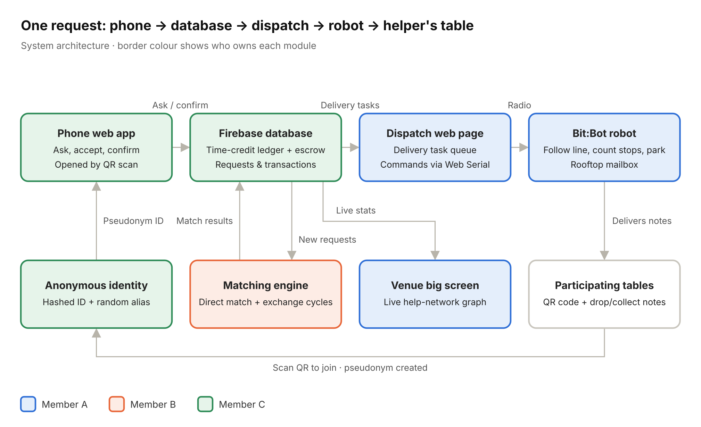

Project Plan & Step-by-Step Handbook (Members A / B / C)

Nov 2026 · Jasmine

This document combines the Loop technical plan and the beginner's handbook into one guide.

- **Part 1 · Project Plan** covers what Loop is and why: the idea, the rules, the system design, the pitch, risks and the equipment list.

- **Part 2 · Step-by-Step Handbook** covers how to build it: every step from borrowing the robots to submitting on Devpost, with what to do, how to do it and how to know it worked.

**Roles used throughout:** Member A owns everything you can see and touch (robot, dispatch, visual design, venue set-up, the story). Member B owns the rules and the brains (ledger rules, matching algorithm, economic model, data). Member C is the code lead (Firebase, ledger code, phone web app, repository, deployment, and helping A and B with their code).

# Part 1 · Project Plan

## 1. Positioning

Loop is an anonymous community for swapping skills and time. At the hackathon, a small robot carries help-request notes to the people who can help. Online, the same rules become a platform where people exchange skills, time and items using **time credits**.

**One-line pitch:** Ask without shame, help without cash.

**The story:** At a hackathon, almost every team gets stuck on something that the team at the next table could fix in five minutes, but many people are too embarrassed to ask, especially beginners and international students who are new to the environment. Loop lets people ask for help anonymously, and rewards the people who help with a fair set of rules.

### Why it has to be a robot (the judges will ask)

- The robot is the only go-between in the room that knows nothing: it recognises table numbers, not people. Askers can ask anonymously without worrying about being recognised.

- The robot is a physical demo of the platform's rules: anonymity, escrow and delivery confirmation become something you can see and touch on site.

- The robot runs **exchange cycles**: when A helps B, B helps C and C helps A, it delivers along the loop, turning the route the algorithm calculates into a real driving route.

### Three layers (the key to making it bigger than a hackathon toy)

| **Layer** | **What it is** | **How it shows up in the competition** |
|----|----|----|
| On site | The robot carries anonymous help notes between teams in the venue | Runs for real for 24 hours, the whole room can take part |
| Platform | Website: time-credit ledger, skill exchange, exchange-cycle matching, anonymity | Every exchange on site runs through this website |
| Vision | Scale to communities and cities: swap items, sell skill time | Interactive prototype pages + simulated data |

**Recommended scope:** Build the skill-and-time exchange for real and make it complete, so it genuinely runs on site. Make item trading an interactive prototype and vision demo. Even with three people, finishing all three layers properly in 24 hours is unrealistic, and judges value a loop that actually works. With a stronger coder on the team, exchange cycles and the item-trading prototype become realistic stretch goals rather than long shots.

## 2. On-site experience

One exchange takes about 15 minutes from scanning the QR code to receiving credits. The asker stays anonymous until they are helped.

1.  **Scan:** Each participating table has a QR code (with the table number in it). Opening the page gives you an anonymous alias, for example "Purple Otter", plus 3 time credits as starter funds.

2.  **Ask:** Write what you need and what you can offer, e.g. "Need: React deployment error / Can offer: 20 minutes of UI colour advice", and set how many credits you will pay.

3.  **Match:** The system searches all requests and skills for the best helper. If there is no direct match, it looks for a 3-person exchange cycle.

4.  **Robot sets off:** The robot drives to the asker's table and lights up. The asker drops a note into the small mailbox on the robot's roof (the note only has the question and a short code, no name).

5.  **Delivery:** The robot drives to the helper's table and beeps. The helper takes the note and taps "Accept" on their phone. The asker's credits go into escrow.

6.  **Help:** The helper can write an answer on the note and send it back with the robot, or, if both agree, "reveal tables" and help in person.

7.  **Confirm:** Once the problem is solved, both confirm on their phones. The escrowed credits go to the helper, and both rate each other.

8.  **Big screen:** A screen in the venue shows a live help-network graph, credits exchanged today and problems solved, but never anyone's identity.

**Why anonymity matters:** The biggest barrier is not that nobody knows the answer, it is that people are embarrassed to ask. Anonymity lowers that barrier, and revealing identity is entirely up to both people.

## 3. Core design

Four sets of rules form the platform's "institutions". This is where Member B's mathematical modelling shines, and it is the part of the pitch that shows the most depth.

### 3.1 Time-credit rules

- **One hour = one time credit:** Skill exchange follows the time-bank principle: everyone's hour is worth the same, whether you code or design. Time banking is a real community model, and the equality itself is a selling point.

- **Starter funds:** New users get 3 credits. Starter funds are the only source of new credits, so Member B can track total supply.

- **Escrow:** When a request is accepted, the credits are frozen and only go to the helper after both confirm. Neither side can run off with them.

- **No cash-out, no top-up:** Credits only circulate inside the community. This keeps the platform focused on mutual help and avoids the problems of treating it as real money. Say this proactively in the pitch.

- **Optional: circulation incentive:** Credits that sit unused slowly shrink a little, encouraging people to help and ask more. Member B can simulate how this rule changes circulation speed.

### 3.2 Anonymity

- On first visit, each device gets a random ID. It is hashed with SHA-256 using the browser's built-in Web Crypto, and the hash is the only identity in the ledger.

- Only a randomly generated alias (e.g. "Purple Otter") is shown. Real names never appear in the ledger or on the big screen.

- The asker's identity is hidden from the helper. Only when both tap "Reveal" do they see each other's table number.

- To be honest: this is pseudonymisation, not full end-to-end encryption. If there is time, also encrypt note content with Web Crypto so only the matched pair can read it.

- Abuse prevention: a report button, a banned-word filter and a reputation score for each alias. Aliases with very low reputation cannot start new exchanges.

### 3.3 Matching and exchange cycles

**Direct match:** When B can offer exactly the skill A needs, candidates are ranked by this score and the highest-scoring helper is chosen:

> score = w1 × skill overlap + w2 × waiting time + w3 × reputation

Skill overlap can be the Jaccard index of the two sets of skill tags (size of intersection ÷ size of union).

**Exchange cycles:** When there is no direct match, or nobody has many credits, draw everyone as a directed graph: if B can meet A's need, add an edge A → B. Then look for cycles of length 3 or less. A helps B, B helps C, C helps A: all three get help and nobody spends a single credit. The idea comes from the Top Trading Cycles algorithm in economics, which is used in real life for kidney exchange matching. The robot delivers the notes around the cycle, so the judges can watch an algorithm turn into a real route.

### 3.4 Item valuation (vision layer)

An item's price in time credits is the product of three factors:

> price = category base price × condition factor × supply-demand factor

- **Category base price:** e.g. how many credits a textbook is worth, set initially by the community.

- **Condition factor:** new = 1.0, like new = 0.8, and so on.

- **Supply-demand factor:** people who want this kind of item ÷ people offering it, capped between 0.5 and 2 to prevent price spikes and crashes.

In the competition this is an interactive prototype page; Member B uses simulated data to show how prices move with supply and demand.

## 4. Roles and division of work

| **Member** | **Responsible for** | **Best suited to** |
|----|----|----|
| Member A | Robot, micro:bit, dispatch page, visual design (page styles, big screen), venue set-up, the pitch story | Someone with a robotics and design background |
| Member B | Ledger rules and time credits, matching algorithm, statistics, economic model, the rules and data part of the pitch | Someone with a data analysis and maths background |
| Member C (code lead) | Firebase set-up, ledger code, anonymous login, phone web app, GitHub repository, deployment, security, code help for A and B | The strongest programmer on the team |

| **Module** | **Owner** | **Output** |
|----|----|----|
| Robot line-following, stop counting, parking (MakeCode) | A | Drives to station N when told and stops with lights on |
| Dispatch web page (connects to micro:bit) | A (C reviews the Web Serial code) | Reads the task queue and sends commands to the robot over USB |
| Visual design: brand, aliases, page styles, big screen | A | Loop's overall look (shared style sheet) and the venue screen |
| Venue: track tape, stations, QR codes, rooftop mailbox | A (B helps) | A site the robot can run on |
| Ledger rules: balance, escrow, transfers, refusal cases | B designs, C codes | Rules on paper, then a correct ledger.js |
| Matching algorithm (direct match + exchange cycles) | B | match.js: a helper or cycle for every request |
| Economic model: supply, circulation, item valuation | B | Simulated data and charts |
| Repository, Firebase project, deployment | C | One shared codebase, one live site |
| Anonymity (hashed ID, alias generation) and abuse protection | C | Only pseudonyms in the ledger; reporting, filters, database rules |
| Phone web app: anonymous login, ask, accept, confirm, reveal | C (using A's styles) | Every page after the QR scan |
| Big-screen data: help-network graph, live stats | A draws, B supplies data | Venue big screen |
| Pitch | A: story and demo; B: rules and data; C: runs the laptops during the demo | 3-minute talk |
| Devpost | A: story, screenshots, video; B: rules and data; C: how we built it | Complete project page |

> **Note:** Member C is the code lead, but keep the stack simple so A and B can still read and change the code: Firebase (anonymous login + real-time database) with plain HTML and JavaScript, and no backend server. A and B can lean on C and on AI coding assistants (check first that the event allows them).

## 5. System architecture and data

Firebase is the hub of the whole system: phones write requests, the matching engine writes results, and the dispatch page listens for tasks and drives the robot through a micro:bit. No custom backend server is needed.

*System architecture · 8 modules, from QR scan to delivery*

The matching engine and ledger rules run directly in the web pages. Member B owns match.js; Member C owns firebase.js and ledger.js and codes the ledger rules B designs.

**Firestore data structure** (confirm in hour 1, then avoid changing it; values are format examples only):

> // users/{hashed ID}: stores only a pseudonym, never a real name
>
> { alias: "Purple Otter", table: 3, balance: 3, held: 0, rating: 4.8,
>
> skills: \["UI design", "Python"\] }
>
> // requests/{id}: one help request
>
> { from: "hashedID", need: \["React"\], offer: \["UI design"\], price: 1,
>
> status: "open", // open / matched / delivering / done
>
> helper: null, cycleId: null, revealed: false }
>
> // transactions/{id}: one time-credit transfer
>
> { from: "hashedID", to: "hashedID", amount: 1, status: "held" }
>
> // held / released / refunded
>
> // tasks/{id}: a delivery job for the robot
>
> { stops: \[3, 5\], status: "queued" } // queued / running / done
>
> **Note:** Fields added during the build in Part 2: requests.code (short note code, H5), tasks.requestId and a created-at time (H5), and requests.revealByAsker / revealByHelper (H15). The two reveal fields replace the single revealed flag.

**Commands from the dispatch page to the robot** (sent over serial to the micro:bit plugged into the laptop, which forwards them by radio):

| **Command** | **Meaning**                              |
|-------------|------------------------------------------|
| GO:3        | Go to station 3                          |
| AT:3        | Robot reports back: arrived at station 3 |
| HOME        | Return to the start                      |

## 6. 24-hour timeline at a glance

Times count from the start of the event (H0). **H8 is the make-or-break line:** by then "scan and ask → robot drives to the asker → robot drives to the helper → credits arrive after confirmation" must work end to end. Detailed steps for each phase are in Part 2.

| **Time** | **Phase** | **Goal** |
|----|----|----|
| Before | Preparation | Learn the tools, borrow equipment, install software, design rules on paper. No project code or designs. |
| H0–H1 | Opening | Hear the theme, pick the angle, recruit 4–6 tables, tape the track, C launches an empty site |
| H1–H5 | Foundations (parallel) | A: robot goes to any station on command. B: matching code with test data. C: login and a correct ledger |
| H5–H8 | Connect everything | One full exchange on two phones, robot drives two stops, credits arrive |
| H8–H14:30 | Live + take turns to sleep | Real users, robot running for real, log problems; key for Spirit of the Hack. Two people always awake |
| H12–H19 | Upgrade features (overlaps the last sleep shift) | Big screen, exchange cycles, reveal, reputation, item-trading prototype, economic simulation |
| H19–H21 | Freeze | Bug fixes only, collect the day's data, rehearse 3 times, record a backup video |
| H21–H24 | Submit | Devpost, timed pitch rehearsal, prepare for judges' questions |

## 7. Pitch

Keep the pitch under 3 minutes. The strongest evidence is: "In these 24 hours, Loop really helped people in this room."

1.  **Opening (20 s, A):** "When I first arrived in London, I was afraid to ask questions. Today, in this room, lots of people are stuck on problems someone else could solve in five minutes."

2.  **Live demo (50 s, A):** Invite a judge to scan and ask anonymously. The robot drives up to collect the note, then delivers it to a helper's table. C stays at the dispatch laptop and big screen, ready to take over manually.

3.  **Real data (30 s, B):** The big screen shows the 24-hour help network, problems solved, credits exchanged and number of exchange cycles.

4.  **Rules and model (40 s, B):** Time-bank principle, escrow, anonymity, the exchange-cycle algorithm, and the economic simulation for a 1,000-person community.

5.  **Vision (30 s, A):** Prototype pages for swapping items and selling skill time: from the hackathon to communities and cities.

6.  **Close (10 s, A):** "Everyone has something someone else needs. They just need a way to ask without fear."

### Questions the judges may ask

| **Question** | **Answer** |
|----|----|
| Why a robot, not a person? | The robot is the only go-between that doesn't recognise people, so the anonymity is believable. It is also a physical demo of the platform's rules. |
| Won't anonymity be abused? | Pseudonyms + reputation score + reporting + escrow, and revealing identity needs both people to agree. |
| Can credits be cashed out? | No. They only circulate inside the community. That is a deliberate design choice that keeps the platform about mutual help. |
| How is this different from second-hand marketplaces? | The core exchange is time and skills, and everyone is equal. Exchange cycles let people with no credits still get help. |

## 8. Risks and fallbacks

The biggest risk is taking on too much and not finishing, so stick strictly to the milestones. The vision layer can be cut to a static page at any time.

| **Risk** | **Fallback** |
|----|----|
| Too many features to finish | Item trading becomes a static prototype or design mock-up; if exchange cycles don't work, use direct matching only |
| Organisers don't allow floor tape or a robot among people | Move the track and stations onto a large table or big sheet of cardboard as a "desktop post office" |
| Line-following is unreliable or the robot miscounts stations | Double line at the start resets the count; if all else fails, switch to manual remote control while the platform keeps running |
| Venue Wi-Fi blocks phones | Firebase is on the public internet, so phones can use mobile data; the dispatch laptop can use a phone hotspot |
| Too few teams join, so no real data | You two plus passers-by act as helpers; run a few more real exchanges before judging |
| Anonymity gets abused | Banned-word filter, reporting, reputation; you also check notes by eye |
| Robot gets stepped on or taken | Bright flag and lights, route along walls or aisles between tables, someone always watching; losses must be paid for under university rules |
| Something breaks during the demo | Play the full video recorded in the freeze phase |

## 9. Equipment list

The core hardware is two robots and two micro:bits borrowed from the university. Everything else is cheap consumables.

| **Item** | **Qty** | **Who brings** | **Notes** |
|----|----|----|----|
| Bit:Bot XL robot | 2 | A | Borrowed from UAL; one main, one spare |
| micro:bit V2.2 | 2 | A | One on the robot, one plugged into the laptop for dispatch |
| Micro USB data cable | 2 | A | For downloading programs and the dispatch connection |
| Robot batteries + spares | 2 sets | A | Check the type when borrowing |
| Laptop | 3 | One each | Dispatch page must run in Chrome |
| External monitor or projector | 1 | Optional | Venue big screen; otherwise use a laptop screen |
| Black and white electrical tape | 1 roll each | B | Track and stop lines; white is the backup for dark floors |
| Large roll of paper or cardboard | 1 | B | Table-top track if floor tape isn't allowed |
| Printed QR codes and instruction cards | 6–10 | B | One per participating table |
| Sticky notes and pens | Plenty | B | For help notes |
| Rooftop mailbox materials | 1 set | A | Small box, tape, little flag |
| Hot glue gun, cable ties | 1 each | A | For styling the robot |
| Extension lead, power bank | 1 each | C |  |
| Spare USB-C/USB hub or adapter | 1 | C | In case a laptop lacks a USB-A port for the micro:bit cable |

# Part 2 · Step-by-Step Handbook

## Status on 14 November and decisions still open

The repository (github.com/2335698577/hack) currently holds a README, a progress note and Member B's Firebase practice page.

| **Member** | **Done** | **Still to do before the event** |
|----|----|----|
| A | Repository created | A-0 to A-7 (borrow robots, MakeCode practice, radio, Web Serial); T-1 email; T-3 QR cards; add B and C as GitHub collaborators |
| B | Node.js, Firebase CLI, anonymous auth, practice page | Verify the Firestore read-back; B-1 JavaScript; B-3 reading; B-4 rules on paper; T-2 real Firebase project |
| C | Joined the team | C-0 to C-3: ticket, invitations, installs, reading, Git cheat sheet |

**Repository housekeeping (C, 10 min):** README links point to docs/progress.md and practice/index.html, but the files sit at the top level; either move them into those folders or fix the links. Update progress.md from two members to three.

> **Note: Decision needed: who taps Done?** Part 1 says both people confirm; the phone flow only has the asker tap Done. Recommended: **the asker's Done releases the credits** (simpler, fewer stuck orders); the helper can use Report if something goes wrong, and C cancels any order left open for more than 2 hours. Agree this at the T-4 call so B's ledger table and C's code match.

## How to use this handbook

This handbook covers the must-have version: anonymous request → robot delivers the note → time credits settle. Every step says what to do, how to do it and how to know it worked. Follow it and tick each item off.

**Format of each step**

- **What:** the goal of the step

- **How:** exactly where to click and what to type

- **✓ Done when:** what you should see; only move on once you see it

- **If stuck:** if it isn't solved within 30 minutes, go to Troubleshooting at the end, or call your teammate over

**Competition red lines**

- Before the event you may only install software, borrow equipment, read official tutorials, practise and design on paper. All project code, pages and designs must be made after the start.

- Email the organisers before the event to confirm AI coding assistants are allowed and that the robot can run on the floor.

- When submitting, state honestly what was pre-existing (Bit:Bot chassis, open-source libraries) and what was built at the event.

**How to ask an AI coding assistant** (after the event starts)

A and B are beginners. When stuck, ask Member C first if C is free; otherwise use an AI coding assistant. The key is asking clearly. Use this template every time:

> I'm a beginner programmer building a project at a hackathon.
>
> \[Tools I'm using\] e.g. Firebase JavaScript SDK (loaded in the page with \<script type="module"\>)
>
> \[What I want\] e.g. a function that signs the user in anonymously and creates their document in the users collection
>
> \[Data structure\] paste the data structure from Part 1, Section 5
>
> \[Requirements\] complete code that runs as-is, with beginner-friendly comments; tell me which file it goes in and how to test it

When you hit an error, paste the full error message and the related code into the AI, and explain "what I did, what I expected, what actually happened".

**Sync rule:** every 2 hours, all three spend 5 minutes checking progress. The integration check at the end of each phase must be done together. **Code rule:** everyone only edits their own files; C merges, reviews and deploys.

## Before the event · Member A

*Goal: by Friday, the robot can drive, the two micro:bits can talk to each other, and you know where every block lives. These are practice exercises to learn the tools; do not bring practice programs into the competition project.*

### A-0 Borrow equipment (Wednesday)

- [ ] On the UAL loans website, add Bit:Bot XL × 2 and micro:bit V2.2 × 2 to the basket, book them, and collect from High Holborn

- [ ] Check on collection: wheels turn, casing isn't cracked, "V2" is printed on the back of the micro:bit

- [ ] Ask what batteries the robot uses (usually AA) and buy at least 2 spare sets

- [ ] Get 2 micro USB **data** cables (charge-only cables can't connect to a computer, so check when buying)

> **✓ Done when:** With batteries in, the lights on both robots come on.

### A-1 Show a picture on the micro:bit (15 min)

1.  Open makecode.microbit.org in **Chrome**, click "New Project" and give it any name

2.  From the "Basic" category on the left, drag a "show icon" block into "on start"

3.  Connect the micro:bit to the computer with the data cable, click "Download" at the bottom left and follow the prompts to pair the device

4.  Once paired, click "Download" again and the program is written straight onto the micro:bit

> **✓ Done when:** The icon you chose appears on the micro:bit's LED grid.
>
> **If stuck:** Won't download: switch to Chrome, try another cable, try another USB port.

### A-2 Load the Bit:Bot extension and make the robot move (30 min)

1.  At the bottom of the block list in MakeCode, click "Extensions", search for bitbot and choose the 4tronix BitBot extension

2.  A new BitBot category appears, with blocks for drive forward, turn, stop, read line sensor, set LEDs and so on

3.  Write a small exercise: press A to drive forward for 1 second, press B to stop

4.  Download it, slot the micro:bit into the connector at the front of the robot (screen facing forward, following the manual), and switch the robot on

> **✓ Done when:** Press A and the robot drives forward; press B and it stops.
>
> **If stuck:** Robot spins on the spot or reverses: check the micro:bit orientation in the manual; start with a low speed (30–40%).

### A-3 Test the line sensors (30 min)

1.  Stick a 2 cm wide strip of black electrical tape on a sheet of white paper

2.  Write an exercise program: loop forever, read the left and right line sensors, and show the left value on the left half of the LED grid and the right value on the right half (or just alternate with "show number")

3.  Put the robot on the white paper, then slowly move it over the black line, and note the readings for "white" and "black"

> **✓ Done when:** You can write down "left sensor reads \_\_ on black and \_\_ on white", and the same for the right.

### A-4 Follow a line using the official example (1 hour)

1.  Find the "line follow" example in the official 4tronix Bit:Bot XL guide or the MakeCode examples, and build it

2.  Tape an oval black loop on the floor or a big sheet of paper (about 1.5 m × 1 m) and let the robot drive round it

3.  Adjust the speed until it can do 3 laps without leaving the line

> **✓ Done when:** The robot does 3 laps in a row without losing the line. Write down the speed value you ended up with.
>
> **If stuck:** Robot keeps shooting off at bends: lower the speed, or tape the bends as wider curves.

### A-5 Send messages between two micro:bits (30 min)

1.  In MakeCode's "Radio" category, find the "radio set group", "radio send string" and "on radio received receivedString" blocks

2.  Make two exercise programs: both boards set the same group (e.g. 7); the first sends "HI" when A is pressed, and the second shows the received text on its screen

3.  Download one program to each micro:bit

> **✓ Done when:** Press A on the first board and "HI" scrolls across the second board.

### A-6 Understand serial and Web Serial (30 min)

1.  In MakeCode's "Serial" category, look at the "serial write line" and "on serial received" blocks

2.  With the micro:bit connected in MakeCode, click "Show console Device" to see the text the micro:bit sends to the computer over USB

3.  Find and read an official getting-started article on the Chrome Web Serial API. You only need three things: a web page can send and receive text with a micro:bit over USB; it must be Chrome or Edge; the page must be https or localhost

> **✓ Done when:** You can explain the chain "web page on the laptop → USB → micro:bit → radio → robot" to your teammate in your own words.

### A-7 Install software

- [ ] Chrome (latest version)

- [ ] VS Code, plus the Live Server extension (to open web pages locally)

- [ ] A GitHub account

- [ ] Create a Firebase account and skim the getting-started guides for anonymous login and Firestore

## Before the event · Member B

*Goal: by Friday, you can sign in to Firebase from a web page and write and read data, and the ledger and matching rules are clearly designed on paper. Do not bring practice projects or code into the competition.*

### B-0 Install software (30 min)

**Status 14 Nov: done.** Node.js 24 (via nvm) and Firebase CLI 15.36.0 installed, Google sign-in through the CLI works. Still to add:

- [ ] GitHub Desktop (the easiest way to commit without the command line)

- [ ] Python with pandas and matplotlib, or Excel, for the economic simulation

### B-1 JavaScript basics (2–3 hours)

Pick any free beginner JavaScript tutorial and learn only these:

- Variables (let, const), arrays, objects

- Functions and arrow functions

- if statements and for loops

- async / await (all Firebase reads and writes use them)

- Press F12 in the browser to open the console, and print things with console.log

- How Firestore stores data as "collections + documents"

> **✓ Done when:** You understand what this sentence asks for: "Write an async function that reads the balance field of an object; if it is at least 1, subtract 1, otherwise print 'insufficient balance'."

### B-2 Firebase practice project (mostly done)

**Status 14 Nov:** anonymous authentication enabled, practice web app registered, practice page in the repository. **Still to verify:** Firestore database created, and the page signs in, writes a dummy record and reads it back from the server. The steps below are kept for reference.

1.  Open the Firebase console (console.firebase.google.com), click "Add project", name it anything, e.g. loop-practice, and turn Google Analytics off

2.  Left menu Build → Authentication → Get started → Sign-in method → Anonymous → Enable → Save

3.  Left menu Build → Firestore Database → Create database → location europe-west2 (London) → Start in test mode

4.  Project settings (gear icon) → Your apps → click the web icon \</\> → Register app → choose "Use a \<script\> tag", and save the config code it shows

5.  Follow Firebase's official web getting-started guide to do two things: sign in anonymously; write one record to a collection and read it back

> **✓ Done when:** You can see the record you wrote from the web page in the Firestore console.
>
> **If stuck:** permission-denied error: check Firestore was created in test mode and that the expiry date in the rules hasn't passed.

### B-3 Background reading

- [ ] The basic rules of time banking and some real-world examples

- [ ] The Top Trading Cycles algorithm and how to find cycles in a directed graph

### B-4 Design the rules on paper (1–2 hours, this is your home turf)

**Ledger state table:** write every case as "before → action → after".

| **Action** | **Asker balance** | **Asker held** | **Helper balance** | **Transaction status** |
|----|----|----|----|----|
| New user joins | +3 | 0 | — | — |
| Helper accepts | −price | +price | unchanged | held |
| Both confirm done | unchanged | −price | +price | released |
| Cancelled or timed out | +price | −price | unchanged | refunded |

Then think through: can someone post a request without enough balance? Can two people accept the same request at once? Can someone accept their own request? Which other cases must be refused?

**Matching rules:** write down the direct-match scoring (skill overlap + waiting time + reputation) and starting weights; then use three people A, B and C to draw an exchange cycle on paper. Also choose starting values for the item-valuation parameters.

**Skill tag list:** list 15–20 tags, e.g. Python, JavaScript, React, UI design, data analysis, maths, hardware, public speaking, pitch editing, English polishing, Git, debugging. People will tick these on the request page.

> **✓ Done when:** All three are written on paper (or in your phone notes); the ledger table is sent to C before the event.

## Before the event · Member C (code lead)

*Goal: everyone can reach the same repository and Firebase project, and you understand the data structure, ledger rules and robot protocol well enough to unblock A and B on the day. No project code before the start.*

### C-0 Join the team

- [ ] Register for DurHack yourself (every team member needs their own ticket) and join the team on the registration/Devpost page

- [ ] Accept the invitation to the GitHub repository and to the Firebase project

### C-1 Install software

- [ ] Chrome, VS Code + Live Server, Git, Node.js (LTS)

- [ ] Firebase CLI: npm install -g firebase-tools, then firebase login with the Google account B added to the project

> **✓ Done when:** firebase --version and git --version both print a version number.

### C-2 Read up (1–2 hours)

- [ ] Part 1 of this document, especially Section 5 (data structure and robot commands)

- [ ] Firestore transactions and real-time listeners (onSnapshot) in the official docs

- [ ] Firestore security rules basics: test mode is open to anyone, so plan simple rules to switch on before judging

- [ ] The Chrome Web Serial API, so you can review A's dispatch page

- [ ] B's ledger state table and refusal cases once B sends them

### C-3 Git workflow for the team (30 min)

Write a five-line cheat sheet for A and B: install GitHub Desktop; clone the repository; only edit your own files; commit and push small changes often; tell C before deploying. Agree that C is the only person who runs firebase deploy.

> **✓ Done when:** A and B have each cloned the (empty) repository and pushed one test commit to a scratch branch.

## Before the event · Together

*Goal: finish every bit of prep that would waste time on the day, without writing any project code.*

### T-1 Email the organisers (tonight or tomorrow)

Copy this email and send it to the organisers' contact address:

> Hi DurHack team,
>
> We're a three-person team planning a hardware + web project. Could you confirm:
>
> 1\. Can we bring a BBC micro:bit and a 4tronix Bit:Bot robot chassis (borrowed from
>
> our university) as base components? All project code and modifications will be
>
> built during the event.
>
> 2\. Can we stick tape on the floor (or use a large sheet of paper) so a small robot
>
> can drive between a few tables?
>
> 3\. Can we put QR codes on a few participating tables?
>
> 4\. Are AI coding assistants allowed?
>
> Thank you!
>
> **✓ Done when:** You get a reply. If floor tape isn't allowed, use a big sheet of cardboard as a table-top track instead.

### T-2 Create the real Firebase project (20 min, B does it, since B's Firebase CLI already works)

This only "opens the account" with no code, so you have a fixed web address in advance for printing QR codes.

1.  In the Firebase console create a new project, e.g. loop-durhack, and note the **project ID** it is given

2.  Same as the practice project: enable anonymous login and create Firestore (europe-west2, test mode)

3.  Add Member A's and Member C's Google accounts as project members (Editor role): Project settings → Users and permissions → Add member

4.  Once live, your site will be at https://PROJECT-ID.web.app

> **✓ Done when:** All three of you can log in to the Firebase console and see the project.

### T-3 Make the QR code cards (30 min, A does it)

1.  One web address per participating table, told apart by table number: https://PROJECT-ID.web.app/?table=1, ?table=2 … 6 in total

2.  Generate a QR code for each with any free online QR generator

3.  Make cards: "Stuck? Ask anonymously." at the top, the QR code and a big table number underneath

4.  Print them, plus one extra "Home" sign for the start point

> **✓ Done when:** Scanning each card with a phone opens an address ending in the right table number. (It will show "page not found" for now. That's normal; it works once the site is live at the event.)

### T-4 Agree roles and data structures (45-min video call, all three)

- [ ] Read the data structure in Part 1, Section 5 together and confirm the field names; C has the final say, and nobody changes them on the day without telling the others

- [ ] Walk through who owns which file (see H0–H1) and the Git cheat sheet

- [ ] Agree the skill tag list so the request page can show it as tick boxes

- [ ] Write the opening and closing lines of the pitch

- [ ] Sort out travel: check trains to Durham and the start time, and plan to arrive early

- [ ] Confirm who brings what (see the equipment list in Part 1, Section 9)

### T-5 Night-before check

- [ ] Two robots, two micro:bits, data cables, spare batteries

- [ ] Black and white electrical tape, big cardboard, sticky notes, pens, QR code cards, hot glue gun

- [ ] All three laptops fully charged, chargers, extension lead, USB adapter

- [ ] Ledger rules and skill tag list (on paper or phone)

## On site H0–H1 · Opening set-up

*Goal for the first hour: the venue is set up, the site opens on a phone, and all three have confirmed who owns which files before starting work. Times count from the start of the event (H0).*

### Together (H0–H0:20)

- [ ] Listen to the opening theme and spend about 10 minutes discussing how Loop fits it (mutual help, connection and community fit almost anything); write the one-line description on paper

- [ ] Pick a spot: a patch of floor near 3–4 other teams' tables

- [ ] Invite those teams. You could say:

> Hi! We're building a little robot that delivers anonymous help notes between teams.
>
> If you get stuck today, you can scan this QR code and ask for help - and earn
>
> credits by helping others.
>
> Would you mind if we put a small station next to your table?

### Member A + Member B (H0:20–H1) · Tape the track

B helps A tape and talks to the participating teams, then starts on match.js test data.

1.  Tape a closed loop of black electrical tape that passes beside every participating table; tape bends as curves, not right angles

2.  Beside each participating table, tape a stop line about 15 cm long across the loop

3.  Number the stop lines 1, 2, 3 … in the robot's direction of travel; put the "Home" sign at the start, tape a line there too and number it 0

4.  Put the matching QR card on each table. **The table number on the card must equal that station's number.**

5.  Put the robot on the track and run a lap with the line-following program you practised

> **✓ Done when:** The robot completes a full lap without leaving the line.
>
> **If stuck:** Floor is too dark to see the black line: use white tape and swap "black" and "white" in the program; failing that, lay down the big cardboard.

### Member C (H0:20–H1) · Create the project and launch an empty page

1.  Make a new folder called loop on your computer and open it in VS Code

2.  Open a terminal in VS Code (menu Terminal → New Terminal) and type firebase init hosting

3.  Choose: use an existing project → the real project made before the event; public directory: press Enter (default public); single-page app: No; GitHub automatic deploys: No

4.  Commit the folder to the GitHub repository so A and B can pull it

5.  A file public/index.html appears; type firebase deploy

6.  The terminal shows a Hosting URL; scan any QR card with a phone

> **✓ Done when:** The phone opens Firebase's default welcome page.

Then create these empty files in the public folder; from here on each of you writes your own:

> public/
>
> index.html phone web app (C)
>
> dispatch.html dispatch page (A)
>
> screen.html venue big screen (A)
>
> css/style.css shared look: colours, fonts, buttons (A)
>
> js/firebase.js Firebase config and initialisation (C)
>
> js/ledger.js ledger: login, balance, escrow, transfers (C)
>
> js/match.js matching rules and cycles (B)
>
> js/skills.js skill tag list (B)
>
> js/stats.js statistics for the big screen (B)
>
> js/phone.js phone app logic (C)
>
> js/dispatch.js dispatch logic (A)

**Sharing code:** everyone commits to the GitHub repository (A and B via GitHub Desktop), only edits their own files, and C pulls, checks and runs firebase deploy from C's computer. If Git causes trouble mid-event, send the file to C instead of fighting it.

## On site H1–H5 · Foundations

*In this phase nobody depends on anyone else: A makes the robot go to any station on command, B writes the matching code against test data, C makes the web page sign in and keep the books correctly. All three must pass their checks by H5.*

### Member A · Robot program (H1–H3:30)

Create a MakeCode project called loop-car and load the BitBot extension. Understand the logic below on paper first, then build it block by block.

**Step 1 · Create 4 variables:** target (which station to go to), current (which station it's at), moving (whether it's driving), N (how many stations, e.g. 4).

**Step 2 · On start**

- Set radio group to 7

- current = 0, moving = false

- Show a smiley face to mean "ready"

**Step 3 · On radio received receivedString**

- If the first 3 characters of receivedString are "GO:": take everything from the 4th character on, convert to a number, store it in target, set moving = true, and show target on screen

- If receivedString is "HOME": target = 0, moving = true

(The "Text" category has "substring" and "parse to number" blocks.)

**Step 4 · Line-following logic in the forever loop** (only runs while moving is true)

1.  Read the left and right line sensors

2.  **Both on black** = it has hit a stop line:

    - current = remainder of (current + 1) ÷ (N + 1) (the remainder block in "Math"), so it goes back to 0 after a full lap

    - If current equals target: stop, moving = false, flash the LEDs green, beep once, and radio-send "AT:" joined with current

    - Otherwise: drive straight for 0.3 s (to cross the line so it isn't counted twice)

3.  **Only left on black:** correct to the left

4.  **Only right on black:** correct to the right

5.  **Both on white:** drive straight

**Step 5 · Buttons**

- Press A: target = 2, moving = true (for testing)

- Press B: current = 0 (press it while the robot sits at Home to reset the count)

> **✓ Done when:** With the robot at Home, press B then A: it drives to station 2, stops and flashes. Correct 3 times in a row.
>
> **If stuck:** Robot mistakes a bend for a stop line: only put stop lines on straight sections, or lower the speed.
>
> **If stuck:** Always counts one station too many: change "drive forward 0.3 s" to 0.5 s.

### Member A · Relay micro:bit (H3:30–H4:30)

Create a project called loop-relay. This board stays plugged into the dispatch laptop and passes messages between the laptop and the robot.

- On start: set radio group to 7

- On serial received a line: radio-send that line

- On radio received receivedString: serial write line receivedString

- Press A: radio-send "GO:1" (for testing)

> **✓ Done when:** Press A on the relay board and the robot drives to station 1; in MakeCode, "Show console Device" shows the robot's reply AT:1.

### Member A · Look and feel (H4:30–H5)

Sketch the three phone pages (home, ask for help, my tasks) on paper, agree them with C, then write css/style.css: colours, font, big rounded buttons, cards. C builds the pages using these styles. **Write all page text in English**, because most participants speak English.

### Member B · Matching code with test data (H1–H5)

B's code is plain JavaScript that takes lists in and gives answers back, so it can be built and tested without the database.

1.  In js/skills.js, export the skill tag list you prepared

2.  In js/match.js, write scoreFor(request, mySkills): how many of the request's needed skills overlap with mine (later: Jaccard index plus the waiting-time and reputation weights)

3.  Write findCycles(openRequests): build the directed graph (edge A → B when B's offered skills cover A's needs) and find cycles of length 3 with three nested loops

4.  Make test data: 10 fake requests, including one set of 3 that need each other, and check results in the browser console

> **✓ Done when:** scoreFor ranks the obvious best helper first, and findCycles finds the planted 3-person cycle and nothing else.

### Member C · Firebase setup (H1–H1:30)

1.  Firebase console → Project settings → Your apps → copy firebaseConfig

2.  Ask the AI:

> I'm a beginner. Using the Firebase JavaScript SDK (via CDN, with \<script type="module"\>),
>
> write a js/firebase.js file that initialises the app and exports auth and db (Firestore).
>
> Here is my config: \[paste firebaseConfig\]
>
> Also write a minimal test.html that uses it and prints "Connected" to the console.
>
> **✓ Done when:** Open test.html with Live Server, press F12, and see "Connected" in the console.

### Member C · Anonymous login and users (H1:30–H2:30)

In js/ledger.js write a function initUser(table) that does four things:

1.  Signs in anonymously

2.  Hashes the uid from sign-in with the browser's built-in crypto.subtle.digest (SHA-256) and uses the hash as the user document ID

3.  If that document doesn't exist in the users collection yet, creates it: alias (a random English "colour + animal" combination, e.g. Purple Otter), table, balance: 3, held: 0, rating: 5, skills: \[\]

4.  Returns this user's data

> **✓ Done when:** Open the test page in a normal window and a private window: two different users appear under users in the Firestore console, each with a balance of 3.

### Member C · Ledger functions (H2:30–H5)

Using B's ledger state table, write 4 functions in js/ledger.js. **Anything that changes a balance must use a Firestore transaction.** B checks the results against the table.

| **Function** | **What it does** | **Must refuse when** |
|----|----|----|
| createRequest(need, offer, price) | Creates a request with status open | Balance is less than the price |
| acceptRequest(requestId) | Helper accepts: asker balance −price, held +price; request status → matched; creates a transaction with status held | Request already accepted; helper is the asker |
| confirmDone(requestId) | Both confirm: asker held −price, helper balance +price; request → done; transaction → released | Request is not matched or delivering |
| cancelRequest(requestId) | Returns the escrowed credits; transaction → refunded | Request is already done |

When asking the AI, paste in the Firestore data structure from Part 1 together with this table.

**✓ Done when** (do these in order in two windows):

1.  User 1 posts a request priced at 1 → User 1's balance is still 3

2.  User 2 accepts → User 1 balance 2, held 1

3.  Confirm done → User 1 held 0, User 2 balance 4

4.  User 1 tries to accept their own request → refused

> **Note: H5 integration check (all three, 10 min):** A shows the robot going to a chosen station at the press of a button; B shows match.js finding the planted cycle; C shows a transfer between two windows. Only move on when all pass.

## On site H5–H8 · Connect everything (make-or-break)

*This phase joins everyone's parts. By H8 you must complete one full run on two phones: ask → accept → robot drives two stops → confirm → credits arrive.*

### Member C · Extra data functions (H5–H6)

Add these to js/ledger.js; the phone app and A's dispatch page need them:

1.  createRequest also generates a two-character short code (e.g. A7) and stores it in the request's code field. The paper note only carries this code, which links it to the request online

2.  After acceptRequest succeeds, automatically create a delivery task in tasks: stops = \[asker's table, helper's table\], requestId, status queued, plus the creation time

3.  watchOpenRequests(callback): listens live to every request with status open

4.  watchMyItems(callback): listens live to "requests I posted" and "requests I accepted"

Meanwhile **Member B** writes the first statistics functions in js/stats.js (problems solved, credits exchanged, members) and acts as tester: run through B's ledger table in two browser windows and report any wrong balance to C.

> **✓ Done when:** Calling these functions from the console produces the matching changes in Firestore.

### Member C · Phone web app (H6–H7:30)

Build three pages in public/index.html and js/phone.js (they can be three sections of one page that show and hide), all text in English, using A's css/style.css:

**Home**

- Read the table number from the end of the address (?table=3)

- Call initUser and show "You are Purple Otter · Table 3 · 3 credits"

- Three big buttons: Ask for help / Help someone / My tasks

**Ask for help**

- Tick the skills you need (from B's js/skills.js)

- Describe the problem in one sentence, with the hint "Don't write your name"

- Tick the skills you can offer

- Choose a price: 1, 2 or 3 credits

- After submitting, show the short code and the message: "Write your question on a sticky note with code A7. The robot will come to you once someone accepts."

**Help someone**

- Show all open requests as live cards: skills needed, description, price

- Sort with B's scoreFor so the best match for my skills is at the top

- An Accept button on each card

**My tasks**

- Show requests I posted and requests I accepted, with their status

- The asker sees a Done button on their own request, which calls confirmDone

> **✓ Done when:** Open it with Live Server on the laptop, press F12 and switch to phone size: all three pages can be clicked and show data.

### Member A · Dispatch page (H5–H7:30, C reviews)

Build a page in public/dispatch.html and js/dispatch.js that is only used on the dispatch laptop. Ask C to review the Web Serial reading code before testing with the robot:

1.  A Connect micro:bit button: on click, use Web Serial to choose the plugged-in relay micro:bit, baud rate 115200, and keep reading the lines it sends

2.  Listen live to tasks with status queued and handle one at a time in order of creation:

    - Set the task to running and its request to delivering

    - Send "GO:first stop" and wait for "AT:first stop" (up to 90 seconds)

    - Wait 30 seconds at the first stop for the asker to drop the note in (add a Next button on the page to continue early)

    - Send "GO:second stop", wait for "AT:second stop", then wait 30 seconds for the helper to take the note

    - Send "HOME" and set the task to done

3.  Show a log, the current task, and a row of manual buttons GO 1, GO 2, GO 3, GO 4, HOME (for taking over by hand if automatic dispatch fails)

> **Note:** The dispatch page must be opened in Chrome, on localhost (Live Server) or the deployed https address, or Web Serial won't work.
>
> **✓ Done when:** Click the manual GO 3 button: the robot drives to station 3 and AT:3 appears in the log.

### Together · H8 make-or-break test (H7:30–H8)

1.  Member C runs firebase deploy in the terminal

2.  On the dispatch laptop, open the deployed dispatch.html and connect the relay micro:bit; put the robot at Home and press B to reset the count

3.  Phone 1 scans table 1's QR code, phone 2 scans table 3's QR code

4.  Phone 1: Ask for help, price 1

5.  Phone 2: Help someone, sees the request, taps Accept

6.  The robot drives to station 1 automatically and phone 1's owner drops the note on the roof; the robot drives to station 3 and phone 2's owner takes the note

7.  The robot returns Home; phone 1 taps Done

8.  Check: phone 1 balance 2, phone 2 balance 4

> **✓ Done when:** All 8 steps succeed, twice in a row.
>
> **If stuck:** If you can't, stop everything else and fix it together, with C leading the debugging. If automatic dispatch really can't be fixed, use the manual buttons on the dispatch page instead; the phone app and ledger carry on as normal.

## On site H8–H14:30 · Go live and take turns to rest

*From here Loop genuinely serves the people in the room: the more real requests, the more convincing your pitch data. Rest in shifts so two people are always awake and one is always with the robot.*

### Together · Grand opening (H8–H8:30)

- [ ] Visit each participating table, show them once how to scan and ask, and leave sticky notes and pens

- [ ] Fit the temporary mailbox on the robot's roof (a small open-topped box held on with tape)

- [ ] Put a sign next to Home: "Loop – anonymous help, delivered by robot"

- [ ] Start a "problem log" sheet: write down every bug or user confusion

### Shift rota

| **Time** | **Member A** | **Member B** | **Member C** |
|----|----|----|----|
| H8:30–H10:30 | Sleep | On duty: robot and users | Fix bugs from the log |
| H10:30–H12:30 | On duty + fix own bugs | Sleep | Fix bugs, start C-12 |
| H12:30–H14:30 | A-12 big screen + robot | B-12 / B-13 | Sleep |

### What the person on duty does

- [ ] Stand by for every delivery; if the robot leaves the line, put it back by hand

- [ ] Invite stuck teams to try it, or scan in yourself as a helper to get the network moving

- [ ] Check note contents and remove anything unfriendly

- [ ] After every delivery, glance at the ledger: are the balances right?

- [ ] Write problems on the problem log, marking each as A's or B's

### Bug triage (H12, while A, B and C are all awake)

Before C goes to sleep, spend 10 minutes going through the problem log together, sort it by "affects the demo first", assign the bugs, then move to the next phase.

## On site H12–H19 · Upgrade features

*Every feature here is a bonus. Do them in order and deploy each one as it's finished; anything not done by H19 is dropped, never carried into the freeze.*

### Member A

**A-12 · Venue big screen (H12–H14, top priority)**

1.  Create screen.html and use the vis-network graph library (loaded from a CDN) to draw the help network: each node is an alias, and each completed exchange adds a line between two aliases

2.  Three big numbers at the top: Problems solved, Credits exchanged, Members, using B's statistics functions

3.  Use live listeners so new connections appear with an animation when an exchange completes

4.  Open it full-screen on the external monitor

> **✓ Done when:** After an exchange completes, a new line appears on the big screen within 5 seconds and the numbers go up by one.

**A-13 · Robot styling (H14–H15)**

- Make a mailbox-style roof from a small box and add a little flag that says Loop

- Fix it with hot glue, without blocking the line sensors or the micro:bit at the front

- Agree the light meanings: blue = delivering, green = arrived, drop or collect your note, red = error

**A-14 · Item-trading prototype (H15–H19)**

- Create market.html with a few sample items (textbook, monitor, bike light …), each showing a time-credit price from B's valuation function (ask C to help wire it up)

- Add a Sell my time page, e.g. "Portfolio review · 1 hour · 1 credit"

- Label the page clearly as Prototype; the buy button only shows a message and never deducts credits

### Member B

**B-12 · Statistics functions (H12–H13)**

Finish js/stats.js for A's big screen: number of completed exchanges, total amount of all released transactions, total users, and the list of help connections (who helped whom, aliases only).

**B-13 · Exchange cycles (H13–H15, with C)**

1.  Turn all open requests into a directed graph: if B's skills cover A's needs, add an edge A → B

2.  Reuse findCycles from H1–H5 on the live open requests

3.  C wires it to the database: when a cycle is found, set all three requests to matched with the same cycleId, **without moving any credits**, and create one delivery task whose stops are the three people's tables; A checks the dispatch page handles three stops

4.  Test first with 6 fake users to confirm cycles are found

> **✓ Done when:** Create 3 fake users who need each other's skills, and the system automatically creates a three-stop delivery task.

**B-14 · Valuation model and economic simulation (H15–H19)**

1.  Write the valuation function: price = category base price × condition factor × supply-demand factor (supply-demand capped at 0.5–2), for A's prototype page

2.  Export from the Firebase console or read the real data directly, and calculate: number of requests, average waiting time until accepted, share of exchanges that were cycles

3.  Build a simulation in Python or Excel: if the community grew to 1,000 people, how would total credits, circulation speed and the share of cycles change?

4.  Make 2–3 charts for the pitch and Devpost

### Member C

**C-12 · Reveal tables (H12–H13)**

- Add revealByAsker and revealByHelper to request documents

- Add a Reveal table button to each item in My tasks; only when both the asker and the helper tap it do they see each other's table number; if only one taps, nothing is shown

**C-13 · Exchange cycles in the database (H14:30–H15:30)**

Wire B's findCycles into Firestore and create three-stop delivery tasks (see B-13).

**C-14 · Reputation, reporting and filters (H15:30–H16:30)**

- In confirmDone, let the asker rate the helper 1–5 and update the helper's rating (average)

- Add a Report button to each request; reported requests are hidden from the list

- Check new requests against a banned-word list and reject any that match

**C-15 · Lock down and harden (H16:30–H19)**

- Replace test-mode Firestore rules with simple rules: only signed-in users can read; a user can only change their own document; balances only change through the ledger functions

- If time allows: encrypt note text with Web Crypto so only the matched pair can read it

- Help A wire the item-trading prototype and B's statistics into the pages

> **Note: Cutting order** (when time runs short, cut from the top): item-trading prototype → economic simulation → reveal tables → reputation and reporting → exchange cycles. Never cut the big screen or the real-data statistics.

## On site H19–H24 · Freeze, rehearse and submit

*From H19, no new features: only bug fixes, demo prep and submission materials. Everything must be submitted at least 1 hour before the deadline.*

### H19–H21 · Freeze and rehearse

**Member A**

- [ ] Fix bugs from the problem log that affect the demo

- [ ] Record a 1–2 minute full demo video on a phone: scan → ask → robot collects the note → delivers → confirm → new line on the big screen

- [ ] Take 5–6 screenshots: the three phone pages, the dispatch page, the big screen, a close-up of the robot

**Member C**

- [ ] Fix bugs from the problem log, then freeze the code: one final firebase deploy and no more changes

- [ ] Check the Firestore rules are on and the site still works from a fresh phone

**Member B**

- [ ] Pull together the day's real data: total requests, problems solved, credits exchanged, average wait until accepted, number of exchange cycles

- [ ] Put the data and simulation charts into 2–3 simple slides to show on the big screen during the pitch

**Together**

- [ ] Rehearse the full pitch (Part 1, Section 7) 3 times, timed on a phone, staying under 3 minutes

- [ ] Ask a passer-by to play judge and ask you questions

- [ ] Double-check: robot batteries are full and spares are within reach

### H21–H23 · Write the Devpost

**Member A writes**

- Project name, one-line summary (Ask without shame, help without cash.), cover image

- Inspiration: the story of being too nervous to ask for help in a new city

- What it does: the on-site experience flow

- Upload the demo video (1–2 min) and screenshots

**Member C writes**

- How we built it: the Bit:Bot + micro:bit + Firebase + Web Serial architecture, how the ledger and escrow are kept correct, security measures

**Member B writes**

- The rules: time-bank principle, escrow, matching and exchange-cycle algorithms

- Challenges: the biggest difficulty and how you solved it

- What we learned: what each of you learned in these 24 hours (this is scored)

- Real-data charts and economic-simulation charts

- Next steps

**Together**

- [ ] C makes the GitHub repository public, with a README that says clearly the Bit:Bot chassis and open-source libraries were pre-existing and everything else was built at the event; add the link to Devpost

- [ ] Fill in Built with: Bit:Bot, micro:bit, MakeCode, Firebase, JavaScript, Web Serial, vis-network, etc.

- [ ] Tick every prize you qualify for (overall, theme prize, Spirit of the Hack, relevant sponsor tracks)

- [ ] Click submit and check the page says it's submitted

### H23–H24 · Before the demo

- [ ] Put the robot at Home, press B to reset the count, and do one full test run

- [ ] Have the dispatch page, big screen and phones all open; set phones not to auto-lock

- [ ] Keep the demo video open on a laptop; if anything breaks on stage, just play it

- [ ] Take a deep breath and have some water

## Troubleshooting

Most problems come from three places: the cable, the browser and the web address. Check those first.

| **Symptom** | **Most likely cause** | **What to do** |
|----|----|----|
| MakeCode won't download to the micro:bit | Charge-only cable; not using Chrome | Change cable, use Chrome, try another USB port, pair again |
| Robot spins on the spot or drives backwards | micro:bit inserted the wrong way; left/right motors reversed | Check the orientation against the manual; swap left and right in the turn blocks |
| Robot keeps shooting off at bends | Too fast; bends too tight | Slow down; tape bends as wide curves |
| Robot stops at the wrong station | Missed or double-counted a stop line | Only put stop lines on straights; cross lines for longer; press B at Home to reset |
| Robot ignores radio commands completely | The two boards are on different radio groups | Set both to the same group (e.g. 7) |
| Connect button on the dispatch page does nothing | Not Chrome; page isn't https or localhost | Open the deployed address or Live Server in Chrome |
| Dispatch page connects but never receives AT:x | Relay program doesn't write radio messages to serial | Check the relay program and download it again |
| QR code scan won't open the page | Not deployed yet; wrong address or table number | Run firebase deploy; check the address in the QR code |
| permission-denied error | Firestore test-mode rules expired or were changed | Check the Firestore rules in the Firebase console |
| Balances go negative or don't add up | No transaction used; same request accepted twice | Use transactions everywhere balances change; check the status is still open before accepting |
| Page changes don't show on the phone | Not redeployed; phone cache | Run firebase deploy again, refresh the phone or open in a private window |
| Venue Wi-Fi can't reach Firebase | Network restrictions | Phones use mobile data; dispatch laptop uses a phone hotspot |
| Git push rejected or merge conflict | Two people edited the same file; local copy out of date | Don't force anything: send your file to C, who merges it |

**The universal three steps**

1.  Press F12 to open the browser console and read the red error messages

2.  Show C, or send the AI, the error, the related code and "what I did, what I expected, what I actually saw"

3.  If it isn't fixed within 30 minutes, use a fallback first so the demo can run (e.g. the manual dispatch buttons), then fix it calmly afterwards
